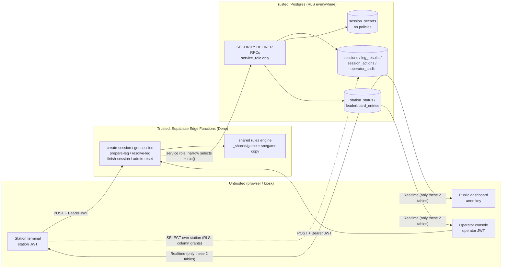
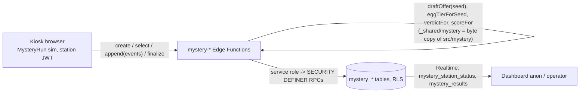

# Security design — live/verified mode (rules v2.5 and mystery-v3.1, see §7)

Scope: Supabase backend in `supabase/**` (schema, RLS, RPCs, Edge Functions) and the client contract it
exposes. LOCAL DEMO mode is explicitly **unverified** and never writes to the leaderboard.

## 1. Architecture and trust boundaries

* **Identity**: Supabase Auth email/password accounts created only by the operator. `app_users(user_id, role,
  station_id)` binds each account to `station` (+ exactly one station) or `operator`. The caller's station is
  **always** taken from this binding, never from the request body.
* **Authority**: Edge Functions load the authoritative `GameState` snapshot and the secret seed, run the
  shared engine (`prepareWithSeed` / `resolveWithSeed` / `abandonSession`), and commit through
  `commit_session_transition` / `create_session_atomic`. The client sends only *decisions*
  (route, push level, egg decision) plus `expectedRevision` and an `actionId`.
* **Writes**: anon/authenticated have **no** INSERT/UPDATE/DELETE privilege or policy on any table and no
  EXECUTE on any write RPC. Every write is service role → SECURITY DEFINER RPC (`search_path = ''`).

## 2. Data classification

| Data | Where | Who can read |
|---|---|---|
| Seed (128-bit) | `session_secrets.seed` | service role only; revealed in API responses only after the session ended |
| Seed commitment SHA-256(seed) | `sessions.seed_commitment`, every view | the station; anyone after publication via the API |
| Raw per-leg draws | `sessions.state` (inside legResults), `leg_results.draws` | service role only (column grants); API redacts while in progress (T-06b) |
| Full GameState snapshot | `sessions.state` | service role only |
| Session key columns, leg key columns | `sessions`, `leg_results` | own station (RLS) and operators |
| Receipts / audit | `session_actions`, `operator_audit` | operators |
| Live terminal status, results | `station_status`, `leaderboard_entries` (+ views) | everyone (anon), Realtime |

## 3. Threat model

| ID | Threat | Mitigation | Verified by |
|---|---|---|---|
| T-01 | **Spoofed station** — a terminal (or anyone with a key) acts as the other station or sends `stationId` in a body | Station derived from JWT → `auth.getUser()` → `app_users` binding; bodies have no station field (unknown keys rejected); other-station session ids return **404** (same as nonexistent) | `002_rls_behaviour`: "station A sees only station_a sessions", "station A cannot read station B session by id"; unit: "rejects unknown keys…"; `_shared/db.ts loadSession` |
| T-02 | **Anonymous / unprovisioned caller** creates or resolves races | `verify_jwt = true` at the gateway + in-function `getUser`; anon key carries no user → 401; Auth user without `app_users` row → 403 `NOT_PROVISIONED`; sign-ups disabled | `002`: anon write attempts on all 9 tables → 42501, "anon cannot execute commit_session_transition", "unprovisioned user sees no sessions"; SUPABASE_SETUP §8 curl |
| T-03 | **Guessed / leaked session id** | UUIDv4 (122 bits); ownership check on every function; RLS on direct reads; ids visible in `station_status` grant nothing | `002` station B/A isolation tests; `_shared/session-flow.ts` |
| T-04 | **Replay** of a captured request | Every transition carries an `actionId`; `(session_id, action_id)` is UNIQUE; a replay returns the *stored* response and changes nothing; same id with a different body/type → 409 `ACTION_ID_CONFLICT` | `003`: "retry with same action id returns the STORED response", "replay wrote no second receipt", "reusing an action id for another action type is rejected"; round-trip test (random replays) |
| T-05 | **Double click / network retry** | Same `actionId` → idempotent (prepare, resolve, finish, and create via `sessions.create_action_id`); concurrent duplicates serialize on row locks — the loser sees the receipt and returns the identical stored response | `003`: "double-click create … replays the original session", "replayed create inserted nothing" |
| T-06 | **Seed discovery** | Seed only in `session_secrets` (RLS on, privileges revoked, **no policies**, not in Realtime); never logged; responses reveal it only when `status !== 'in_progress'` (`buildSessionView`); 128-bit entropy from `crypto.getRandomValues`; SHA-256 commitment published at creation and re-checked in SQL | `001`: "session_secrets has no policies at all", privilege tests, publication test; `002`: anon/station/operator cannot read secrets; round-trip: "seed string absent while open"; unit: seed format + SHA-256 vector |
| T-06b | **RNG state recovery from revealed draws** (found during this work) | The engine's `keyedUniform` (FNV-1a + murmur3, 32-bit) is not a PRF: the two leg-1 draws in `LegResolution.draws` pin the hash states after the `seed|` prefix and predict **every** later roll (weather, egg offers, crash, Hyde) exactly. Mitigation: while a session is in progress the API returns `draws: null` for every resolution, `sessions.state` and `leg_results.draws` are not granted to clients, and stored receipts are already redacted. Draws are returned once the session ended (seed revealed anyway). **Long-term fix (engine owner): replace `keyedUniform` with an HMAC-SHA-256 keyed PRF in a future rules version.** | `supabase/tests/unit/rng-leak.test.ts` (proves the attack: 24/25+ sessions fully predicted); unit "strips draws and seed while in progress"; round-trip `checkRedaction` on every response; `001` column-privilege tests |
| T-07 | **Client score / state tampering** (sending scores, rolls, completion, HP) | Bodies are strict allow-lists (unknown keys → 422); the server never reads client state; scores, times, rolls, DNF and completion are computed by the engine from the stored snapshot + secret seed; `verified_at/completed_at` are server timestamps; RPC sanity-checks successor state (same session/nickname/character/pokemon, revision strictly increases, action/status coherence, leg index) | unit: "rejects … client-sent state" (`finalScore`, `roll`); `003`: INVALID_TRANSITION cases; round-trip: 600 races, columns == engine state |
| T-08 | **Stale tab / two tabs on one station** | Optimistic concurrency on `revision` (engine check + RPC check under `FOR UPDATE`) → 409 `STALE_REVISION` with `currentRevision`; creating a new race supersedes the old one (`abandoned`, `superseded`) → old tab gets 409 `SESSION_CLOSED`; partial unique index guarantees ≤ 1 in-progress session per station | `003`: "different action on an old revision -> STALE_REVISION", supersede tests, "the database itself refuses a second in-progress session" |
| T-09 | **Double publication / leaderboard tampering** | Leaderboard rows written only inside `commit_session_transition` on the in_progress→completed/dnf transition; PK `session_id` + `ON CONFLICT DO NOTHING`; closed sessions can never transition again; UPDATE trigger makes entries immutable even for the owner | `003`: "published exactly once", "replaying the finishing action…", "new actions on a completed session -> SESSION_CLOSED", "published entries are immutable" |
| T-10 | **Admin abuse** (operator resets a rival, edits results) | Operators can only *abandon* (unranked) via `admin-reset`; there is no API to edit or publish results; every reset requires a reason and is recorded with actor id in `operator_audit` and `session_actions.actor_user_id`; operators cannot read seeds | `003`: operator reset audit tests; `002`: "operator cannot read session_secrets", "operator cannot DELETE sessions" |
| T-11 | **Key leakage** | anon/publishable key is public by design and grants only SELECT on the two projections; service role key exists only in the Edge runtime (platform-injected) and briefly in the operator's shell for provisioning (env var, never argv/files); `.env*` git-ignored; station password leak → rotate via script or ban user (functions reject banned users) | `001`: privilege matrix; SUPABASE_SETUP §5, §10 |
| T-12 | **Privilege drift** (Supabase default grants, forgotten revoke, new table without RLS) | Migrations `REVOKE ALL` then grant minimal SELECTs; structural tests fail on any write privilege, any non-SELECT policy, any public table without RLS, any EXECUTE on write RPCs, any extra Realtime table | `001` (32 assertions); mutation run: weakening grants/policies/publication produced 10 failing assertions |
| T-13 | **Deadlock / lost update under concurrency** | Single lock order `stations → sessions` in every RPC; all multi-row effects in one transaction | design review (`20261021000300_session_rpcs.sql` header) |
| T-14 | **Input abuse** (huge bodies, markup in nicknames, odd unicode) | 4 KB body cap (413); JSON object only; nickname sanitized by the engine (`sanitizeNickname`) and re-checked by SQL CHECK (length 3–15, no `<>&"'\`` or control chars); operator note sanitized, ≤ 200 chars | unit validation tests; `sessions_nickname_check` |
| T-15 | **Session spam** | Max 6 new sessions per station per minute (`RATE_LIMITED` 429); Auth rate limits for sign-in | `create_session_atomic` |
| T-16 | **Cross-origin abuse** | Bearer-token auth (no cookies) → no CSRF; optional `ALLOWED_ORIGINS` pin → 403 `ORIGIN_NOT_ALLOWED` | unit CORS tests |

## 4. Deviations from the requested architecture (with justification)

1. **RPC return envelope.** `commit_session_transition` / `create_session_atomic` return
   `{ok:true, replay, response}` or `{ok:false, error, message, ...details}` instead of the bare `p_response`,
   so the function can tell a replay (`x-idempotent-replay` header) and map business errors without parsing
   exception text. Unexpected faults still raise and roll back.
2. **Draw redaction + column grants (T-06b).** Not in the brief; required because revealed draws break seed
   secrecy. `leg_results` stores `resolution` *without* `draws` plus a service-only `draws` column;
   `sessions.state` is excluded from the `authenticated` column grant (clients must list columns; `select=*`
   on `sessions` is refused by design).
3. **Idempotent create.** `create-session` takes an `actionId`; `sessions.create_action_id` is unique per
   station and the create response is stored as a `create` receipt. Prevents a double click from superseding
   the session that was just started. The RPC also verifies `commitment == sha256(seed)` and rate-limits.
4. **Supersede in SQL.** When a new session supersedes a running one, the RPC patches the old snapshot with
   exactly the fields `abandonSession()` changes (status, phase, prepared, scores, revision+1). This keeps the
   swap atomic in one transaction; the round-trip test asserts the patch equals the engine's `abandonSession()`
   output field-for-field.
5. **Extra objects.** `operator_audit` (who reset what, why); `release_station` (player leaves the results
   screen → station shows idle); `operator_reset_station` (clears the public row + audit, refuses while a race
   is still in progress so the abandon always goes through the engine). `station_status` has extra sanitized
   columns (`label`, `route`, `push_level`, `weather`, `stamina`, `final_score`, `notice`) and uses
   `status = 'idle'` (with `notice`) instead of showing an abandoned session.
6. **`stations` is not readable by anon** (labels are exposed through `station_status.label`).
7. **Other-station sessions answer 404**, not 403, to prevent enumeration.
8. **Millisecond timestamps.** `completed_at/verified_at` are truncated to ms so the SQL ranking and the
   engine's `compareScoreRecords` (which parses ISO timestamps at ms precision) agree on ties.
9. **HP projection clamp.** The `hp` column is clamped to 0..100 (the engine already clamps at 0); the raw
   value remains in the snapshot.
10. **DNF entries** are written to `leaderboard_entries` with `status='dnf'`, score 0 and `dnf_reason`/`dnf_leg`;
    they appear only in `defeated_log`, never in `verified_leaderboard`.

## 5. Observability

* Structured JSON logs per request (`fn`, `requestId`, `status`, `durationMs`, `level`) plus domain events
  (`session_created`, `transition_committed`, `stale_retry`, `operator_reset`). Bodies, JWTs and seeds are
  never logged. `x-request-id` is accepted from the client (validated) or generated, and returned in the
  response header and every error body — correlate a kiosk error with the Edge log line.
* Health: Supabase manages liveness/readiness of the runtime; there is no Prometheus scrape endpoint on
  hosted Edge Functions. RED metrics come from the function logs (Dashboard → Edge Functions → Logs /
  log drains). Suggested event-day alert thresholds: 5xx rate > 1 % over 5 min; p95 `durationMs` > 1500 ms
  (cold starts included); any `INVALID_TRANSITION` (indicates engine/DB drift → stop and investigate).

## 6. Residual risks / not covered

* **Kiosk physical access.** A player at a terminal can open devtools and call the functions with the
  station JWT. They gain nothing the UI does not already show (all secrets are server-side), but they can
  start/abandon races on *their* station. Use kiosk mode, and sign terminals out after the event.
* **Operator and project owner are trusted.** An operator can abandon (not alter) races; the Supabase
  project owner / service key holder can do anything (trust root). Keep operator accounts few.
* **No per-request rate limit on prepare/resolve.** Bounded by the state machine (≤ 7 transitions per race)
  and by the per-station create limit.
* **Nicknames are not profanity-filtered.** Moderation is a manual delete (SUPABASE_SETUP §10).
* **Not executed against real Supabase.** See the validation note in the delivery report: SQL ran on PGlite
  (Postgres 18 WASM) with a Supabase-compat layer; functions were type-checked, not run under Deno.

---

## 7. Mystery v3.1 "The Silent Evidence" (rules `mystery-v3.1`)

Additive backend: `supabase/migrations/20261021000500..800`, `20261022000100_mystery_cases.sql` (three cases),
`20261023000100_mystery_overhaul.sql` (telemetry + live forecasts, §7.7), `20261024000100_mystery_crackstone.sql` (second
enemy + curse, §7.8), functions `mystery-*`, `admin-reset` (`scope`).
Setup and client contract: `docs/SUPABASE_SETUP.md` §12. Status: tested offline (PGlite + Vitest + round-trip); everything
through `20261023000100` deployed 2026-10-24 (owner); `20261024000100` **not deployed yet**.

### 7.1 What changed in the trust model

In v2.5 the server *was* the game: the client sent decisions, the server rolled every outcome from a secret seed.
In v3.1 the browser runs a 60 Hz real-time simulation (movement, collision, Hyde hearing/sight/chase, catches) and the
server receives **events**, not inputs. The server is therefore authoritative only for what it can derive:

| Authoritative on the server | Browser-controlled (validated for shape/order only) |
|---|---|
| caller identity + station binding (JWT → `app_users`) | where the player walked, whether they were really near a clue / the tower |
| seed issuance (`crypto.getRandomValues`, 128 bit) | the sim time `t` of each event (active seconds) |
| the three cards (`draftOffer(seed)`, stored before the client sees them) | whether/when the Hyde caught the player, HP |
| selection ∈ stored offer | which cosmetic events are sent (noise, stance, ability use) |
| egg tier (from the seed) and its points | egg security values |
| event order rules (clues unique/valid, pickup → delivery → accusation → finish, ≤ 1 terminal) | |
| verdict (shared `verdictFor`) and score (shared `scoreFor`), recomputed at finalize | |
| one immutable result per session; rules-version partition; test runs never ranked | |

### 7.2 Data classification (new data)

| Data | Where | Who can read |
|---|---|---|
| Seed | `mystery_sessions.seed` | owning station (the sim needs it), operator; never anon, never Realtime |
| Offered cards | `mystery_offered_duos` | owning station, operator |
| Gameplay events, clue events | `mystery_events`, `mystery_clue_events` | owning station, operator |
| Forecasts / recommendations | `mystery_forecasts`, `mystery_recommendations` | owning station, operator |
| Receipts | `mystery_session_actions` | operator |
| Verified results, live status | `mystery_results` (+ views), `mystery_station_status` | everyone (anon), Realtime; `is_test` rows operator-only |

No personal data beyond the visitor-chosen nickname (3–15 chars, sanitized, CHECK-constrained). Keyboard input and
per-frame state are never stored (events only; the 1 Hz snapshots stay in the browser).

### 7.3 Threat model (mystery)

| ID | Threat | Mitigation | Verified by |
|---|---|---|---|
| M-01 | **Forged / favourite cards** (client invents its offer or picks any of the 126 pairs) | Server issues the seed and stores `draftOffer(seed)` at create, after a sanity check (3 cards, valid ids, distinct pairs, stats 1–5, seed match); select must match a stored card; composite FK `(id, selected_slot)` → offered row; unique (session, slot) and (session, character, pokemon) | 005 "select: a pair that was not offered", "mixing character and Pokemon of two cards"; 004 duplicate-pair offer refused; unit "sanity check refuses tampered offers"; round-trip "stored offer == draftOffer(seed)" |
| M-02 | **Offer / egg rerolling** (refresh until a good offer or a legendary egg) | Refresh = same `actionId` → the same session and offer (replay); a new offer needs a new session, which supersedes the open one (abandoned, unranked, audited) and is rate-limited (6/min/station) | 005 create replay / supersede / RATE_LIMITED; round-trip refresh check |
| M-03 | **Egg tier / points inflation** | Delivered tier must equal `eggTierForSeed(seed)` (same tuning object as the sim) and points must equal the tier's points; SQL CHECK `egg_points ∈ {0,1,3,6}` and `score = egg_points × 100 − active_time_s` | unit `egg_tier`, `egg_points`, SQL-CHECK parity sweep (60 000 cases); 004 score CHECK |
| M-04 | **Verdict tampering** (claim "case solved") | Verdict, `correct` and accused are recomputed from validated `clue_found` + `accusation` events with the shared `verdictFor`; client claims stored in `client_claim`, mismatch flagged (`claim_matches = false`, warn log); CHECK `case_solved ⇒ correct ∧ 3 clues` | unit "client claims are recorded and compared, never trusted"; 004 solved-requires-three-clues |
| M-05 | **Order cheats** (accuse before delivering, deliver without pickup, same clue twice, two finishes, events after the end, catch after deposit) | Pure validator (`_shared/mystery-events.ts`) rejects the whole batch (422 `EVENT_REJECTED {seq, rule}`); DB backstops: unique (session, seq), one finish/dnf, one accusation, one delivery, unique clue per session, monotonic seq/t re-checked in SQL | unit "event order rules" (all rules); 004/005 backstops; round-trip corrupt streams |
| M-06 | **Replay / duplicate / divergent resend** | (session, seq) unique; a resent event is ignored only if byte-identical to the stored one, otherwise 409 `SEQ_CONFLICT`; optimistic concurrency on `last_seq` (`STALE_EVENTS`, auto-retried) | unit "resend dedupe"; 005 STALE_EVENTS / seq-below-last; round-trip resends store nothing twice |
| M-07 | **Double finalization / result edits** | `mystery_results` PK = session; a second finalize returns the stored row (`replay`); immutability trigger; finalize re-validates every stored rule event from scratch and cross-checks it with the incremental state | 005 "second call returns the SAME stored row", "exactly one result row", immutable; round-trip |
| M-08 | **Cross-station access** | Station from JWT only (bodies have no station field; unknown keys → 422); every RPC re-checks `station_id`; RLS own-station-or-operator on every detail table; other station's ids → 404 | 004 station A/B isolation, unprovisioned user; unit "rejects stationId in body" |
| M-09 | **Storage / CPU abuse** | 256 KB body, ≤ 500 events and ≤ 50 forecasts/recommendations per call (invalid analytics records dropped, §7.7 M-17), ≤ 20 000 events per session, strict payload schemas, string caps, 6 creates/min/station | unit parser tests; 005 RATE_LIMITED |
| M-10 | **Test data on the public board** | `testSeed` accepted only with server secret `MYSTERY_ALLOW_TEST_SEEDS=true` (403 otherwise); `is_test` rows excluded from all views and from the anon policy | 005 "test-seed run is stored but never ranked"; unit TEST_SEED_FORBIDDEN |
| M-11 | **Back-filled predictions** (analytics honesty) | Forecast rows are immutable at issue (resend ignored); `model_label ∈ {ml, rule_based}`; recommendation `accepted/outcome` are fill-only | 005 forecast/recommendation tests |
| M-12 | **Browser/server rule drift** (different offers, tiers or verdicts) | `npm run sync:shared` copies the pure modules byte-for-byte (fails on impure code or out-of-tree imports); identity test; redeploy after every sync | `supabase/tests/unit/shared-identity.test.ts` |
| M-13 | **Privilege drift** | Same REVOKE-then-grant pattern; structural tests on RLS, policies, RPC EXECUTE, security_invoker views, exact Realtime publication list | 004 structure block; 001 publication assertion |
| M-14 | **v2.5 contamination** | Separate tables/views/RPCs; no v2.5 object altered; mystery rows can never reach `leaderboard_entries` | 005 "v2.5 … untouched"; round-trip v2.5 snapshot check |

### 7.4 Practical anti-cheat limits (browser-controlled movement)

Be explicit with the team and visitors: **mystery scores are "server-verified for consistency", not cheat-proof.**
A person with devtools on a signed-in kiosk can post a fabricated but rule-consistent event stream, for example three
`clue_found`, `egg_pickup`, `egg_delivered` at `t = 40`, a correct accusation and `finish`. The server would accept it
and rank it (score up to `6 × 100 − 40` only if the seed's egg is legendary). The server **cannot** detect this because
it never sees inputs or positions.

What a cheater **cannot** do: choose or forge cards, change the egg tier or points, claim a verdict that the submitted
clues/accusation do not support, publish twice or edit a result, write for the other station, touch the v2.5 board,
or make a DNF rank above a finisher.

Operational mitigations for the event: kiosk/fullscreen mode, staff at the stations, station accounts only on the kiosks
(sign out afterwards), Realtime dashboard visibility of every run, operator deletion of suspicious results
(`docs/SUPABASE_SETUP.md` §12.5). `received_at` per event lets an operator compare wall-clock arrival with the claimed
active time.

Post-event hardening options (not implemented): (1) a plausibility floor — minimum active time derived from map path
lengths and the duo's max speed; (2) **full server re-simulation** — the sim is deterministic per seed at a fixed 60 Hz
step, so sending the compact per-step input stream instead of events would let the server replay the run with the same
`MysteryRun` and derive every event itself (cost: bandwidth and Deno CPU per run).

### 7.5 Deviations from the brief (with justification)

1. **The seed is not secret** (unlike v2.5): the browser simulation needs it. It is still server-issued, stored before
   use and bound to the offer, so it cannot be chosen.
2. **Separate `mystery_*` tables** instead of reusing `sessions`/`station_status`: the v2.5 tables have v2.5-specific
   CHECKs and FKs; reusing them would require ALTERs on deployed objects.
3. **Extra function `mystery-get-session`** for refresh/reconnect (returns the stored offer and `lastSeq`).
4. **Natural idempotency** for select and finalize (no `actionId`): same choice → replay; finalize always returns the one
   stored result. `actionId` is kept for create, where it distinguishes "retry" from "new visitor".
5. **`admin-reset` default `scope: "all"`** resets both games on the station; a mystery-only reset writes its audit row
   with note prefix `[mystery]` (the v2.5 `operator_audit.action` CHECK is not altered).
6. **`hp` is not stored** in `mystery_results`: it is not derivable from events (heals are not emitted). Catches are.
7. **Forecasts and recommendations ride on `mystery-append-events`** (no extra endpoints; one in-flight queue).
8. **`001` publication assertion updated** to the new exact list (the invariant "exact allow-list" is unchanged).
9. **Sim time stored as `double precision`** so `round1(t)` on the server equals the browser's value bit-for-bit.

### 7.6 Observability (mystery)

Same JSON request logs (`fn`, `requestId`, `status`, `durationMs`) plus `mystery_session_created`,
`mystery_duo_selected`, `mystery_events_appended` (accepted/duplicates/lastSeq), `mystery_stale_retry`,
`mystery_finalized` (outcome, score, verdict, `claimMatches`; warn when false), `mystery_analytics_dropped` (warn: invalid
forecast / recommendation records left out, with up to 5 reasons) and `mystery_progress_mismatch` (error:
stored events vs stored state disagree — investigate). Suggested alerts: any `INVALID_TRANSITION` or
`mystery_progress_mismatch`; `EVENT_REJECTED` rate > 5 % of append calls (sim/validator drift after a deploy — e.g. the
frontend went live before the functions); any `CASE_OUTDATED` after the first minutes of a deploy (mixed function
versions); `mystery_analytics_dropped` on most runs (client analytics drift); `claimMatches=false` on more than an
occasional run.

### 7.7 Overhaul review (2026-10-23: case worlds, randomized sites, telemetry, live forecasts)

Scope: migration `20261023000100_mystery_overhaul.sql`, `_shared/mystery-events.ts`, `_shared/mystery-validation.ts`,
the generated `_shared/mystery/**` (case content v2, `data/caseWorlds.ts`). Setup + deploy order:
`docs/SUPABASE_SETUP.md` §12.7. Nothing new is readable by `anon`; no new grant, policy, column or Realtime table.

**New data and who can read it**

| Data | Where | Who can read |
|---|---|---|
| Per-session layout (which candidate site holds each clue / the egg, Hyde spawn) | nowhere on the server; derived in the browser from the seed + the public `caseWorlds.ts` priors | the owning kiosk (it has the seed) |
| Telemetry that reveals that layout after the fact (`site_checked{found}`, `trace_found`, `hyde_emerged`) | `mystery_events` | owning station, operator (same RLS as every event); never anon, never Realtime |
| Live forecasts `egg_site` / `clue_area` / `hyde_zone` / `hyde_spawn` | `mystery_forecasts` | owning station, operator |

**Threats**

| ID | Threat | Severity | Mitigation / status | Verified by |
|---|---|---|---|---|
| M-15 | **Layout derivable from the seed.** The seed is necessarily on the kiosk (the browser runs the sim, LIVE and LOCAL); `layout.ts` + the public PRF + `caseWorlds.ts` let a devtools user compute every clue site, the egg site and the Hyde spawn before searching. | Low | Accepted. Impact: a faster run (less searching) → a better time/score on the leaderboard. It cannot change the egg tier/points (seed-bound, M-03), the verdict (server answer key, M-04) or anything on the other station. It is strictly weaker than the already-accepted fabricated-stream risk (§7.4: a devtools user can post a whole consistent run). A server-held layout would need a server-authoritative "is the clue here?" oracle on every interaction (latency, impossible in LOCAL mode) — not justified for a school booth. Operational: kiosk/fullscreen lock, staff at the stations, operator deletion of implausible results (`received_at` vs `active_time_s`). | design review; `mystery-sim-contract.test.ts` (the server needs no positions) |
| M-16 | **Forged telemetry** (fake `site_checked`, `trace_found`, `hyde_emerged`, `hazard_triggered`) | Low | Shape-validated only (ids `^[a-z][a-z0-9_]{0,39}$`, enums, booleans, finite bounded numbers, ≤ 6 extra short primitives); telemetry is never a rule event, so it cannot change catches, clues, egg, verdict or score; it only pollutes the forging station's own analytics rows. Bounded by the 20 000-event budget and 256 KB bodies. | `mystery-overhaul.test.ts` "interleaved telemetry leaves … the result unchanged"; `007` "telemetry never changes the rule projections" |
| M-17 | **Analytics record kills verification** (one NaN / over-long feature / unknown target → 422 → kiosk stops uploading → visitor's run unverified, off the board) | Medium → **fixed** | Forecast / recommendation records are now best-effort: invalid ones are dropped and counted (`forecastsDropped`, `recommendationsDropped`, warn log), the events are stored. List shape (array, ≤ 50) and every SQL CHECK still enforced; accepted records are unchanged. | `mystery.test.ts` "an invalid analytics record is DROPPED…"; `007` CHECK backstops |
| M-18 | **Sim/validator enum drift** — the sim emitted `hyde_mode` reason `gave_up`, which the server rejected: any live run in which the Hyde abandoned an unreachable investigation would have turned unverified | High → **fixed** | `gave_up` accepted. Drift guards now fail the build first: server enums vs the synced `types.ts` unions (event types, noise sources, stances, rooms, Hyde modes/reasons), TS lists vs the latest SQL CHECK lists, client `FORECAST_TARGETS` ⊆ server, and 48 real bot episodes per run of the suite uploaded through the server rules with the result compared to the browser's `RunResult`. | `mystery-overhaul.test.ts`, `mystery-sim-contract.test.ts` |
| M-19 | **Deploy skew** (new frontend + old functions → `EVENT_REJECTED: type` for every run; mixed function versions → `CASE_OUTDATED`; a session open across the switch → `CASE_OUTDATED`) | Medium (operational) | Runbook order: DB → all mystery functions in one command → frontend, between visitors, after an operator reset of both kiosks; rollback frontend + functions together. | `docs/SUPABASE_SETUP.md` §12.7 |
| M-20 | **Hidden truth on public surfaces** — the Laptop 1 board and the heartbeat broadcast are visible to everyone in the booth (incl. the player at the other kiosk) | Advisory | Must show only public state (`InvestigationState`-derived posteriors, counts), never the layout, `map.clues`, `map.eggSpawn` or the seed of a live session; the heartbeat stays enums + clamped numbers (§7.5). Owned by the client (fullstack / frontend); the database exposes no layout to anon. | client leakage-guard tests (owners) |

Answer keys are unchanged by the overhaul: `CaseSolution` v2 carries the same culprits and supporting evidence, stays in
the server registry, and leaves the server only in the finalize `reveal`.

### 7.8 Joseph Crackstone review (2026-10-24: second enemy, curse, crackstone_risk)

Scope: migration `20261024000100_mystery_crackstone.sql`, `_shared/mystery-events.ts`, `_shared/mystery-rules.ts`,
`_shared/mystery-validation.ts`. Setup + deploy order: `docs/SUPABASE_SETUP.md` §12.8. **RLS, grants, column privileges and
the Realtime publication are unchanged**: Crackstone telemetry and `curse` rows live in `mystery_events`, `crackstone_risk`
in `mystery_forecasts` — owning station + operator only, never `anon`, never Realtime (pgTAP `008`). Crackstone's
position is never stored server-side; `crackstone_sighted.distanceM` / scan radius are bounded numbers, not coordinates.

| ID | Threat | Severity | Mitigation / status | Verified by |
|---|---|---|---|---|
| M-21 | **Forged / inconsistent curse HP** (a curse that "costs" HP while blocked, HP on a cast / miss, a curse after the deposit, a fake `hp_depleted` DNF) | Low | `curse` is a strict RULE event: phase enum, `hpLost` finite 0..100, 0 unless `phase = hit` and not `blocked`; no hit after the deposit or the terminal event; it is never a catch (`second_catch` still needs two `catch` events). A dnf `hp_depleted` is accepted only when catch + curse HP loss ≥ max HP (heals only raise that bar). HP loss is part of `ruleFingerprint`, so finalize re-validates it from the stored rows. A DNF has no score, so forging one gains nothing; under-reporting HP loss is the accepted fabricated-stream risk (§7.4). | `mystery-crackstone.test.ts`, `mystery-sim-contract.test.ts` (Crackstone stream), `008` |
| M-22 | **Sim/validator drift or deploy skew for the new types** (a Crackstone client against the overhaul server → `422 EVENT_REJECTED: type` → runs unverified) | Medium (operational) | Drift guards extended: Crackstone unions + every GameEvent member's payload keys vs the server schema, TS lists vs the latest CHECK / rule-index definitions. Runbook: DB → all six functions in one command → frontend, hard-reload laptops. | `mystery-overhaul.test.ts`; `docs/SUPABASE_SETUP.md` §12.8 |

## 7.5 Mystery station heartbeat (added 2026-10-21, live client)
Each kiosk broadcasts an ephemeral Realtime heartbeat every 2 s on the public topic `raven-mystery-live` so Laptop 1 can show
"Signal lost" after 15 s without traffic (table rows only change when data arrives, which would falsely flag the tutorial,
card or pause screens). The payload carries only enums and clamped numbers; names, duos, scores and standings shown on the
board always come from server rows. The topic is spoofable with the anon key, but only cosmetically: forged payloads are
dropped or clamped and never rendered (tests/integration/mysteryBoard.test.ts).
