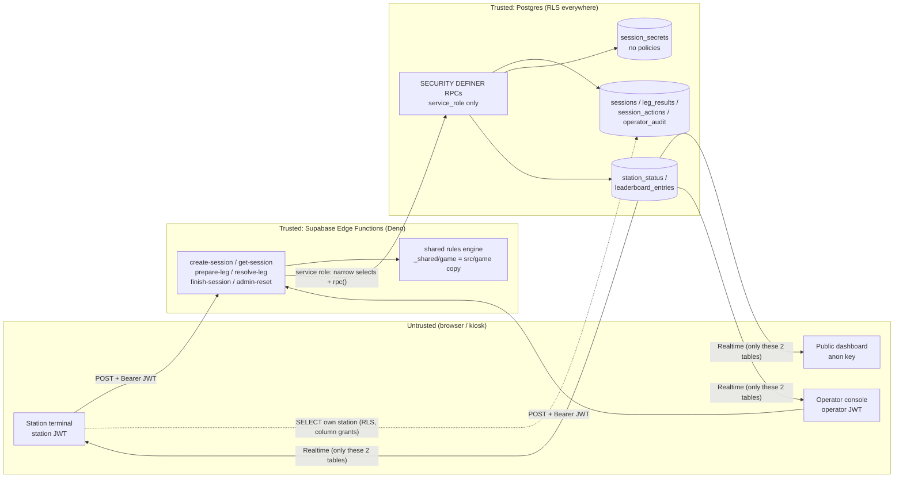

# Security design — live/verified mode (rules v2.5)

Scope: Supabase backend in `supabase/**` (schema, RLS, RPCs, Edge Functions) and the client contract it
exposes. LOCAL DEMO mode is explicitly **unverified** and never writes to the leaderboard.

## 1. Architecture and trust boundaries

* **Identity**: Supabase Auth email/password accounts created only by the operator. `app_users(user_id, role,
  station_id)` binds each account to `station` (+ exactly one station) or `operator`. The caller's station is
  **always** taken from this binding, never from the request body.
* **Authority**: Edge Functions load the authoritative `GameState` snapshot and the secret seed, run the
  shared engine (`prepareWithSeed` / `resolveWithSeed` / `abandonSession`), and commit through
  `commit_session_transition` / `create_session_atomic`. The client sends only *decisions*
  (route, push level, egg decision) plus `expectedRevision` and an `actionId`.
* **Writes**: anon/authenticated have **no** INSERT/UPDATE/DELETE privilege or policy on any table and no
  EXECUTE on any write RPC. Every write is service role → SECURITY DEFINER RPC (`search_path = ''`).

## 2. Data classification

| Data | Where | Who can read |
|---|---|---|
| Seed (128-bit) | `session_secrets.seed` | service role only; revealed in API responses only after the session ended |
| Seed commitment SHA-256(seed) | `sessions.seed_commitment`, every view | the station; anyone after publication via the API |
| Raw per-leg draws | `sessions.state` (inside legResults), `leg_results.draws` | service role only (column grants); API redacts while in progress (T-06b) |
| Full GameState snapshot | `sessions.state` | service role only |
| Session key columns, leg key columns | `sessions`, `leg_results` | own station (RLS) and operators |
| Receipts / audit | `session_actions`, `operator_audit` | operators |
| Live terminal status, results | `station_status`, `leaderboard_entries` (+ views) | everyone (anon), Realtime |

## 3. Threat model

| ID | Threat | Mitigation | Verified by |
|---|---|---|---|
| T-01 | **Spoofed station** — a terminal (or anyone with a key) acts as the other station or sends `stationId` in a body | Station derived from JWT → `auth.getUser()` → `app_users` binding; bodies have no station field (unknown keys rejected); other-station session ids return **404** (same as nonexistent) | `002_rls_behaviour`: "station A sees only station_a sessions", "station A cannot read station B session by id"; unit: "rejects unknown keys…"; `_shared/db.ts loadSession` |
| T-02 | **Anonymous / unprovisioned caller** creates or resolves races | `verify_jwt = true` at the gateway + in-function `getUser`; anon key carries no user → 401; Auth user without `app_users` row → 403 `NOT_PROVISIONED`; sign-ups disabled | `002`: anon write attempts on all 9 tables → 42501, "anon cannot execute commit_session_transition", "unprovisioned user sees no sessions"; SUPABASE_SETUP §8 curl |
| T-03 | **Guessed / leaked session id** | UUIDv4 (122 bits); ownership check on every function; RLS on direct reads; ids visible in `station_status` grant nothing | `002` station B/A isolation tests; `_shared/session-flow.ts` |
| T-04 | **Replay** of a captured request | Every transition carries an `actionId`; `(session_id, action_id)` is UNIQUE; a replay returns the *stored* response and changes nothing; same id with a different body/type → 409 `ACTION_ID_CONFLICT` | `003`: "retry with same action id returns the STORED response", "replay wrote no second receipt", "reusing an action id for another action type is rejected"; round-trip test (random replays) |
| T-05 | **Double click / network retry** | Same `actionId` → idempotent (prepare, resolve, finish, and create via `sessions.create_action_id`); concurrent duplicates serialize on row locks — the loser sees the receipt and returns the identical stored response | `003`: "double-click create … replays the original session", "replayed create inserted nothing" |
| T-06 | **Seed discovery** | Seed only in `session_secrets` (RLS on, privileges revoked, **no policies**, not in Realtime); never logged; responses reveal it only when `status !== 'in_progress'` (`buildSessionView`); 128-bit entropy from `crypto.getRandomValues`; SHA-256 commitment published at creation and re-checked in SQL | `001`: "session_secrets has no policies at all", privilege tests, publication test; `002`: anon/station/operator cannot read secrets; round-trip: "seed string absent while open"; unit: seed format + SHA-256 vector |
| T-06b | **RNG state recovery from revealed draws** (found during this work) | The engine's `keyedUniform` (FNV-1a + murmur3, 32-bit) is not a PRF: the two leg-1 draws in `LegResolution.draws` pin the hash states after the `seed|` prefix and predict **every** later roll (weather, egg offers, crash, Hyde) exactly. Mitigation: while a session is in progress the API returns `draws: null` for every resolution, `sessions.state` and `leg_results.draws` are not granted to clients, and stored receipts are already redacted. Draws are returned once the session ended (seed revealed anyway). **Long-term fix (engine owner): replace `keyedUniform` with an HMAC-SHA-256 keyed PRF in a future rules version.** | `supabase/tests/unit/rng-leak.test.ts` (proves the attack: 24/25+ sessions fully predicted); unit "strips draws and seed while in progress"; round-trip `checkRedaction` on every response; `001` column-privilege tests |
| T-07 | **Client score / state tampering** (sending scores, rolls, completion, HP) | Bodies are strict allow-lists (unknown keys → 422); the server never reads client state; scores, times, rolls, DNF and completion are computed by the engine from the stored snapshot + secret seed; `verified_at/completed_at` are server timestamps; RPC sanity-checks successor state (same session/nickname/character/pokemon, revision strictly increases, action/status coherence, leg index) | unit: "rejects … client-sent state" (`finalScore`, `roll`); `003`: INVALID_TRANSITION cases; round-trip: 600 races, columns == engine state |
| T-08 | **Stale tab / two tabs on one station** | Optimistic concurrency on `revision` (engine check + RPC check under `FOR UPDATE`) → 409 `STALE_REVISION` with `currentRevision`; creating a new race supersedes the old one (`abandoned`, `superseded`) → old tab gets 409 `SESSION_CLOSED`; partial unique index guarantees ≤ 1 in-progress session per station | `003`: "different action on an old revision -> STALE_REVISION", supersede tests, "the database itself refuses a second in-progress session" |
| T-09 | **Double publication / leaderboard tampering** | Leaderboard rows written only inside `commit_session_transition` on the in_progress→completed/dnf transition; PK `session_id` + `ON CONFLICT DO NOTHING`; closed sessions can never transition again; UPDATE trigger makes entries immutable even for the owner | `003`: "published exactly once", "replaying the finishing action…", "new actions on a completed session -> SESSION_CLOSED", "published entries are immutable" |
| T-10 | **Admin abuse** (operator resets a rival, edits results) | Operators can only *abandon* (unranked) via `admin-reset`; there is no API to edit or publish results; every reset requires a reason and is recorded with actor id in `operator_audit` and `session_actions.actor_user_id`; operators cannot read seeds | `003`: operator reset audit tests; `002`: "operator cannot read session_secrets", "operator cannot DELETE sessions" |
| T-11 | **Key leakage** | anon/publishable key is public by design and grants only SELECT on the two projections; service role key exists only in the Edge runtime (platform-injected) and briefly in the operator's shell for provisioning (env var, never argv/files); `.env*` git-ignored; station password leak → rotate via script or ban user (functions reject banned users) | `001`: privilege matrix; SUPABASE_SETUP §5, §10 |
| T-12 | **Privilege drift** (Supabase default grants, forgotten revoke, new table without RLS) | Migrations `REVOKE ALL` then grant minimal SELECTs; structural tests fail on any write privilege, any non-SELECT policy, any public table without RLS, any EXECUTE on write RPCs, any extra Realtime table | `001` (32 assertions); mutation run: weakening grants/policies/publication produced 10 failing assertions |
| T-13 | **Deadlock / lost update under concurrency** | Single lock order `stations → sessions` in every RPC; all multi-row effects in one transaction | design review (`20261021000300_session_rpcs.sql` header) |
| T-14 | **Input abuse** (huge bodies, markup in nicknames, odd unicode) | 4 KB body cap (413); JSON object only; nickname sanitized by the engine (`sanitizeNickname`) and re-checked by SQL CHECK (length 3–15, no `<>&"'\`` or control chars); operator note sanitized, ≤ 200 chars | unit validation tests; `sessions_nickname_check` |
| T-15 | **Session spam** | Max 6 new sessions per station per minute (`RATE_LIMITED` 429); Auth rate limits for sign-in | `create_session_atomic` |
| T-16 | **Cross-origin abuse** | Bearer-token auth (no cookies) → no CSRF; optional `ALLOWED_ORIGINS` pin → 403 `ORIGIN_NOT_ALLOWED` | unit CORS tests |

## 4. Deviations from the requested architecture (with justification)

1. **RPC return envelope.** `commit_session_transition` / `create_session_atomic` return
   `{ok:true, replay, response}` or `{ok:false, error, message, ...details}` instead of the bare `p_response`,
   so the function can tell a replay (`x-idempotent-replay` header) and map business errors without parsing
   exception text. Unexpected faults still raise and roll back.
2. **Draw redaction + column grants (T-06b).** Not in the brief; required because revealed draws break seed
   secrecy. `leg_results` stores `resolution` *without* `draws` plus a service-only `draws` column;
   `sessions.state` is excluded from the `authenticated` column grant (clients must list columns; `select=*`
   on `sessions` is refused by design).
3. **Idempotent create.** `create-session` takes an `actionId`; `sessions.create_action_id` is unique per
   station and the create response is stored as a `create` receipt. Prevents a double click from superseding
   the session that was just started. The RPC also verifies `commitment == sha256(seed)` and rate-limits.
4. **Supersede in SQL.** When a new session supersedes a running one, the RPC patches the old snapshot with
   exactly the fields `abandonSession()` changes (status, phase, prepared, scores, revision+1). This keeps the
   swap atomic in one transaction; the round-trip test asserts the patch equals the engine's `abandonSession()`
   output field-for-field.
5. **Extra objects.** `operator_audit` (who reset what, why); `release_station` (player leaves the results
   screen → station shows idle); `operator_reset_station` (clears the public row + audit, refuses while a race
   is still in progress so the abandon always goes through the engine). `station_status` has extra sanitized
   columns (`label`, `route`, `push_level`, `weather`, `stamina`, `final_score`, `notice`) and uses
   `status = 'idle'` (with `notice`) instead of showing an abandoned session.
6. **`stations` is not readable by anon** (labels are exposed through `station_status.label`).
7. **Other-station sessions answer 404**, not 403, to prevent enumeration.
8. **Millisecond timestamps.** `completed_at/verified_at` are truncated to ms so the SQL ranking and the
   engine's `compareScoreRecords` (which parses ISO timestamps at ms precision) agree on ties.
9. **HP projection clamp.** The `hp` column is clamped to 0..100 (the engine already clamps at 0); the raw
   value remains in the snapshot.
10. **DNF entries** are written to `leaderboard_entries` with `status='dnf'`, score 0 and `dnf_reason`/`dnf_leg`;
    they appear only in `defeated_log`, never in `verified_leaderboard`.

## 5. Observability

* Structured JSON logs per request (`fn`, `requestId`, `status`, `durationMs`, `level`) plus domain events
  (`session_created`, `transition_committed`, `stale_retry`, `operator_reset`). Bodies, JWTs and seeds are
  never logged. `x-request-id` is accepted from the client (validated) or generated, and returned in the
  response header and every error body — correlate a kiosk error with the Edge log line.
* Health: Supabase manages liveness/readiness of the runtime; there is no Prometheus scrape endpoint on
  hosted Edge Functions. RED metrics come from the function logs (Dashboard → Edge Functions → Logs /
  log drains). Suggested event-day alert thresholds: 5xx rate > 1 % over 5 min; p95 `durationMs` > 1500 ms
  (cold starts included); any `INVALID_TRANSITION` (indicates engine/DB drift → stop and investigate).

## 6. Residual risks / not covered

* **Kiosk physical access.** A player at a terminal can open devtools and call the functions with the
  station JWT. They gain nothing the UI does not already show (all secrets are server-side), but they can
  start/abandon races on *their* station. Use kiosk mode, and sign terminals out after the event.
* **Operator and project owner are trusted.** An operator can abandon (not alter) races; the Supabase
  project owner / service key holder can do anything (trust root). Keep operator accounts few.
* **No per-request rate limit on prepare/resolve.** Bounded by the state machine (≤ 7 transitions per race)
  and by the per-station create limit.
* **Nicknames are not profanity-filtered.** Moderation is a manual delete (SUPABASE_SETUP §10).
* **Not executed against real Supabase.** See the validation note in the delivery report: SQL ran on PGlite
  (Postgres 18 WASM) with a Supabase-compat layer; functions were type-checked, not run under Deno.
